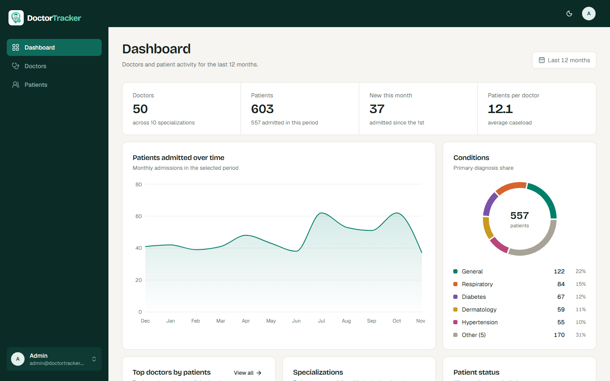
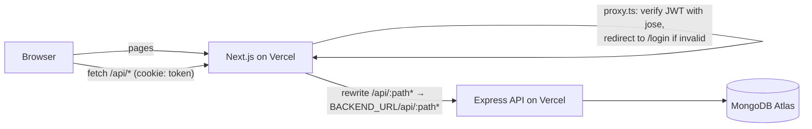
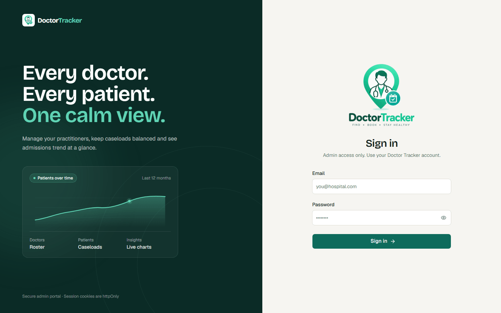
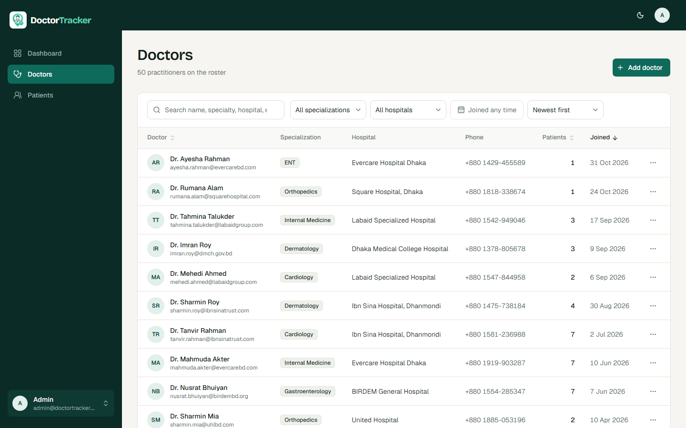
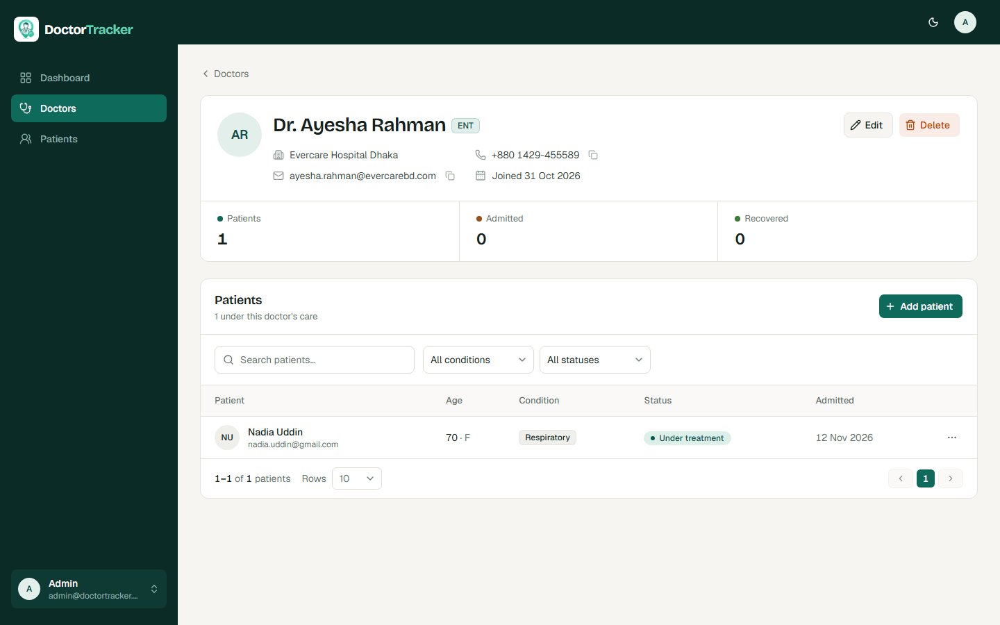
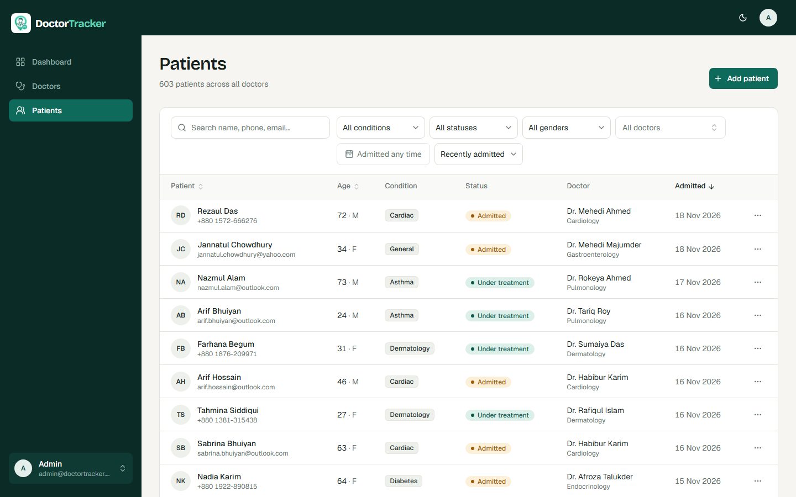
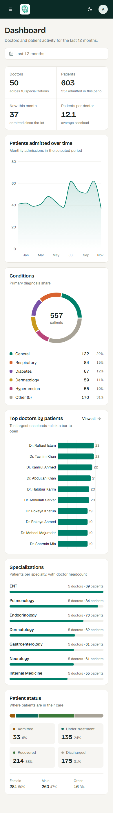
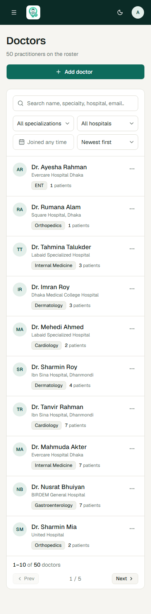

# DoctorTracker — Frontend

Admin portal for managing doctors and their patients. Admins sign in, browse and filter the doctor roster, open a doctor to manage their caseload, search and edit every patient, and read a dashboard of admissions, conditions, statuses and caseloads over any date range. Built with Next.js 16 (App Router), TanStack Query and Recharts on top of an Express + MongoDB API.

**Live:** https://doctor-tracker-frontend-lemon.vercel.app
**API:** https://doctor-tracker-backend-eight.vercel.app ([backend repo](https://github.com/EzazAsif/doctor-tracker-backend))
**Demo login:** `admin@doctortracker.com` / `Admin@12345`



## Features

- Cookie-based auth, with route protection in `src/proxy.ts`. Logged-out users get sent to `/login` and come back to the page they asked for.
- Dashboard: KPI strip, admissions-over-time area chart, conditions donut, top doctors bar chart, specialization and status breakdowns, and a date-range filter.
- Doctors: search, specialization/hospital/date filters, sortable columns, pagination, add/edit dialog, delete confirm.
- Doctor detail: profile with copyable contact info and status counts, plus their patient table with add, edit and remove.
- Patients: search plus condition, status, gender, doctor and admission-date filters, an edit drawer, and optimistic delete.
- Search, filters, sort and page all live in the URL, so any view can be shared and back/forward works.
- Forms use react-hook-form + zod, and 400/409 errors from the API land on the right field.
- Skeletons, empty states, error states with retry, and toasts.
- Responsive down to 375px (tables turn into cards on mobile and the sidebar becomes a sheet), with light and dark themes.

## Setup

Requires Node 20+ and a running backend (local or the deployed one).

```bash
git clone https://github.com/EzazAsif/doctor-tracker-frontend.git
cd doctor-tracker-frontend
npm install
cp .env.example .env.local
```

Fill in `.env.local`:

| Variable | What it is |
| --- | --- |
| `BACKEND_URL` | Base URL of the Express API, no trailing slash. `http://localhost:5000` locally or `https://doctor-tracker-backend-eight.vercel.app`. Server-side only; the `/api` rewrite uses it. |
| `JWT_SECRET` | Same secret the backend signs tokens with. `proxy.ts` uses it to verify the session cookie. |

```bash
npm run dev      # http://localhost:3000
npm run build    # production build
npm run lint
```

## Architecture



**How data flows.** Pages are thin server components that render a client "view". A view reads its search, filters, sort and page from the URL (`useUrlState`) and turns them into a params object, and that object becomes the TanStack Query key. Fetching goes through a small typed client (`src/lib/api/client.ts`). It calls same-origin `/api/...` and turns the API's `{ error: { code, message, details } }` shape into an `ApiError`. A 401 sends the user back to `/login`.

Lists keep the previous page on screen while the next one loads (`placeholderData: keepPreviousData`), so tables don't flash empty. Mutations invalidate exactly the queries they affect: a patient change refreshes patient lists, doctor counts and the dashboard. Patient deletes are optimistic, so the row disappears immediately and comes back if the request fails.

```
src/
  app/
    login/                 sign-in page
    (app)/                 authenticated shell (sidebar + header)
      dashboard/  doctors/  doctors/[id]/  patients/
  components/
    common/                DataTable, Pagination, SearchInput, FilterBar, DateRangePicker,
                           ConfirmDialog, EmptyState, ErrorState, PageHeader, StatStrip
    charts/                chart cards (area, donut, bars, breakdowns)
    doctors/ patients/     forms, dialogs, pickers, column defs
    layout/                app shell, sidebar, user menu, theme toggle
  hooks/queries/           TanStack Query hooks + query key factory
  lib/api/                 typed client, endpoints, types
  proxy.ts                 route protection
```

Re-renders are kept down with memoized table rows and column definitions, stable `useCallback` handlers, and a search input that holds its own text state and only reports the debounced value.

## Technical decisions

### 1. Rewrite proxy and a first-party httpOnly cookie, not a cross-site bearer token

The frontend and the API run on different Vercel domains. The obvious setup has the browser call the API directly and store a JWT in `localStorage`, sending it as `Authorization: Bearer`. That makes the token readable by any script on the page, so a single XSS bug leaks the session. A cookie set by the API's domain doesn't fix it either: it's a third-party cookie from the browser's point of view, so it needs `SameSite=None` and gets blocked outright by Safari and by Chrome's third-party cookie restrictions.

Instead, `next.config.ts` rewrites `/api/:path*` to `${BACKEND_URL}/api/:path*`. The browser only ever talks to its own origin, so the backend's `token` cookie (`httpOnly`, `Secure`, `SameSite=Lax`) is first-party. JavaScript can't read it, and the browser attaches it automatically. That brings three more benefits:

- **No CORS.** There's no preflight on every request and no credentials config to get wrong.
- **Real route protection.** Next's proxy (the old middleware) can read the same cookie and verify the JWT with `jose` before any page renders. Logged-out users never see a flash of protected UI.
- **Hidden backend URL.** `BACKEND_URL` is server-only, so the backend address never ships in the client bundle.

The trade-off is one extra hop through Vercel's edge per API call, and `JWT_SECRET` has to be shared between the two deployments. For an admin tool, both are worth the safer session model.

### 2. TanStack Query plus URL search params, not Redux or Context

Almost all the state in this app is server state: lists, details and stats that live in MongoDB. Redux or a Context store would mean writing the fetch, cache, loading, error, refetch and invalidation logic by hand, then keeping it in sync with the server after every mutation. TanStack Query already does that:

- caching keyed by params, with sensible `staleTime`s
- request de-duplication and cancellation through `AbortSignal`
- `keepPreviousData` for smooth pagination
- retry only on non-4xx errors
- targeted `invalidateQueries` after mutations
- optimistic updates with rollback

The remaining "client state" is mostly the user's view: search text, filters, sort and page. Putting that in the URL instead of a store means:

- a filtered view can be bookmarked or shared
- refresh doesn't lose it
- back and forward walk through filter changes
- there's a single source of truth, because the query key is built from the URL

Filter changes use `router.replace`, so typing doesn't flood the history, and page changes use `push`, so back works. Search is debounced before it reaches the URL. What's left is genuinely local UI state (which dialog is open, which row is being edited), and that stays in `useState`. The result has no global store at all.

## Screenshots

| Login | Dashboard |
| --- | --- |
|  |  |
| **Doctors** | **Doctor detail** |
|  |  |
| **Patients** | |
|  | |

Mobile:

<p>
  
  
</p>

## Tech stack

Next.js 16 (App Router, `proxy.ts`), React 19, TypeScript, Tailwind CSS v4, shadcn/ui on Base UI, TanStack Query v5, Recharts, react-hook-form + zod, jose, date-fns, next-themes, sonner. Deployed on Vercel.
